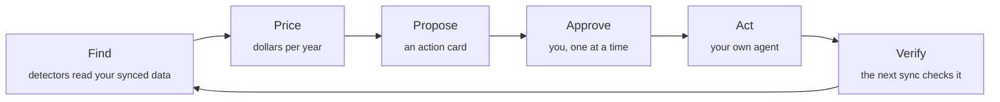

<p align="center">
  
</p>

<h1 align="center">Tidysum</h1>

<p align="center">
  <strong>Your money, in good order, without making investing a second job.</strong><br>
  A self-hosted money hub that finds money in the wrong place, says what it costs you per year,<br>
  and lets your own AI agent fix it, one approved action at a time.
</p>

<p align="center">
  <a href="#quick-start">Quick start</a> ·
  <a href="#how-it-works">How it works</a> ·
  <a href="docs/guide.md">Guide</a> ·
  <a href="DISCLAIMER.md">Disclaimer</a> ·
  <a href="LICENSE">MIT License</a>
</p>

---

> [!IMPORTANT]
> Tidysum is software you run yourself, not a financial adviser. Nothing it shows or drafts is
> financial, tax or legal advice. You approve every action, your own AI agent carries it out, and
> you are responsible for both. Read the [disclaimer](DISCLAIMER.md) before you use it.

## Why Tidysum

Most people have money sitting in the wrong place without knowing it: checking that earns nothing
while a savings account down the street pays 4%, a card that earns 1% on groceries when another in
the wallet earns 3%, a 401(k) fund that charges ten times what the plan's own index funds do, a
contribution rate that misses part of the employer match. Each one is small. Together they cost
real money every year, and finding them takes the kind of attention most people would rather spend
on anything else.

Tidysum is for people who **don't want investing to be a second job**: who'd like their money looked
after the way a good adviser would, without watching markets, reading fund fact sheets or logging
in to six websites. It does the noticing and the arithmetic. You make the calls.

- **Everything in one place.** Connect your banks, cards, brokerages and retirement plans through
  Plaid, or import a CSV. Your data stays in a Postgres database on your own computer.
- **Every finding has a price.** Not "your allocation drifted" but "this costs you $240 a year,
  and here is the fix".
- **One decision at a time.** Fixes arrive as plain action cards. Approve one, skip one, reorder
  them, or schedule one for a later date.
- **Your agent does the legwork.** Bring the AI agent you already use (Claude Code, or any MCP
  client). It reads your data through Tidysum's tools and, once you approve an action, carries out
  the steps on the institution's own website, handing back to you for sign-ins and codes.
- **Calm by design.** New money does the rebalancing, so nothing you own gets sold to chase a
  target. Moves that would take money out of the market wait for calm markets.

## What it looks for

| Area                    | What Tidysum checks                                                                    |
| ----------------------- | -------------------------------------------------------------------------------------- |
| Cash                    | Cash above your buffer earning less than the best account you'd qualify for            |
| Idle cash, looking back | What that cash has already cost you, day by day, over up to two years                  |
| Credit cards            | Which card to use per spending category, cards missing from your wallet, foreign fees  |
| Card statements         | Statement balances that would cost interest if not paid in full by the due date        |
| Debt                    | Spare cash that would save more paying down the highest-APR debt                       |
| 401(k) contributions    | Missed match, room under the yearly limit, reaching the limit before the last paycheck |
| 401(k) funds            | Expensive funds that the plan's own index funds can copy exactly, sleeve by sleeve     |
| Brokerage windows       | Money in a plan's self-directed window that would be simpler and cheaper back inside   |
| IRAs                    | Unused Roth IRA room, including the backdoor Roth when income is over the limit        |
| Investments             | Where each new dollar should go to reach your target mix, without selling              |

Investment checks are off by default and only run for a user with investing turned on.

## How it works

Every feature is one step of a single loop ([decision 0003](docs/decisions/0003-misallocation-loop.md)):



Tidysum itself is plain, deterministic code: the sync, the detectors, the math, your policy, the
approval gate and an append-only audit log. It has **no AI of its own**. The intelligence comes
from the agent you bring ([decision 0005](docs/decisions/0005-actions.md)):

| Tidysum does                                          | Your agent does                                        |
| ----------------------------------------------------- | ------------------------------------------------------ |
| Syncs accounts and keeps the numbers exact            | Talks ideas through with you                           |
| Finds misallocations and prices them per year         | Reads your data through Tidysum's read-only MCP tools  |
| Checks every proposal against your hard limits        | Suggests fixes as proposals                            |
| Shows you one action at a time, and records your call | Carries out approved actions on institutions' websites |
| Confirms the result with the next sync                | Hands sign-ins, codes and signatures back to you       |

### Built to be safe with your money

- **Nothing moves without your approval.** Agents can read and propose; only you approve, on
  Tidysum's own Actions page. There is no approve tool an agent could call.
- **Agents can't see your secrets.** Agent queries run as a read-only Postgres role with
  row-level security. Plaid tokens are encrypted at rest and that role is never granted them.
- **Money is never a float.** Amounts are decimal strings in code and `numeric` in Postgres.
- **Everything is recorded.** Every proposal, approval and agent step is an append-only audit
  event, with the exact data it was checked against.
- **Bank text is data, never instructions.** Account and merchant names are marked untrusted for
  every agent that reads them.
- **No referral money.** Products are ranked only by what they'd gain you, from published terms.
  Tidysum has no affiliate links and no payout fields.
- **Local first.** It runs on your computer, and by default the admin page listens only on
  loopback.

## Quick start

You need Node 22.19 or newer, [pnpm](https://pnpm.io), Docker, and a
[Plaid](https://dashboard.plaid.com/signup) account (the free Sandbox is enough to try it).

```sh
git clone https://github.com/lucidity-finance/tidysum.git && cd tidysum
pnpm install
docker compose up -d                  # Postgres on 127.0.0.1:5432
cp .env.example .env                  # add your Plaid keys and a token key (see below)

pnpm tidysum migrate
pnpm tidysum link-sandbox             # a test bank with two years of history
pnpm tidysum sync
pnpm tidysum serve                    # open http://127.0.0.1:8080
```

In `.env`, set `PLAID_CLIENT_ID` and `PLAID_SECRET` from Plaid's dashboard (Developers → Keys) and
generate `TIDYSUM_TOKEN_KEY` with `openssl rand -base64 32`. Keep that key safe: losing it means
linking every account again.

When you're ready for real accounts, switch `PLAID_ENV` to `production`, open the admin page and
click **Link institutions**. Institutions Plaid can't reach can come in as CSV
(`pnpm tidysum import-csv`). On a Mac, `deploy/macos-setup.sh` runs it all in the background and
keeps it running ([guide](docs/guide.md#running-on-your-mac)).

### Connect your agent

With Claude Code, run this once in the repo, in your own terminal:

```sh
pnpm tidysum agent setup              # --dry-run shows what it would change
```

It registers Tidysum's MCP server, links the [tidysum-actions skill](skills/tidysum-actions/SKILL.md)
(the workflow and rules your agent follows), and allows Tidysum's tools so your agent isn't stopped
at every step. None of that lets it move money: approvals stay with you.

Then ask it things like _"What is my money costing me?"_ or _"Carry out my approved Tidysum
actions."_ For browser steps, give it a browser tool such as Claude in Chrome.

Any other MCP client works too: run `pnpm -s --dir /path/to/tidysum tidysum mcp` as a stdio
server, or set `TIDYSUM_MCP_TOKEN` and use the Streamable HTTP endpoint at `/mcp`.

### Make it yours

Tidysum works from three files you write and keep out of git:

| File             | What it holds                                                     | Start from                                         |
| ---------------- | ----------------------------------------------------------------- | -------------------------------------------------- |
| `policy.json`    | Your hard rules: cash buffer, target mix, caps                    | [`policy.example.json`](policy.example.json)       |
| `plan.md`        | Your plan in words: goals, where each dollar goes, rules you keep | [`docs/plan.example.md`](docs/plan.example.md)     |
| `workplace.json` | Your 401(k) as its website shows it: pay, elections, fund lineup  | [`workplace.example.json`](workplace.example.json) |

Load them with `pnpm tidysum policy set policy.json`, `pnpm tidysum plan set plan.md` and
`pnpm tidysum workplace set <account_id> workplace.json`. Your agent reads the plan before it
suggests anything and keeps its suggestions inside it.

## Status

Tidysum syncs, finds, prices, proposes and records approvals today, and your agent can carry out
approved actions that aren't trades. **Nothing in this repository can move money on its own.**
Placing trades from Tidysum (Phase 4) is not built yet.

| Phase | What                                                         | State                |
| ----- | ------------------------------------------------------------ | -------------------- |
| 0     | Setup, Plaid Sandbox sync, Robinhood MCP spike               | done (spike pending) |
| 1     | Real accounts, scheduled sync, webhooks, CSV import          | done                 |
| 2     | Read-only MCP server for agents                              | done                 |
| 3     | Policy, findings, proposals and approvals; agent-run actions | done                 |
| 4     | Trades placed by Tidysum after approval                      | not started          |

It is built and used by one person on their own money, so expect rough edges, U.S. accounts only,
and a Mac-first setup.

## Learn more

- **[Guide](docs/guide.md):** every command, detector and rule, running on a Mac, layout and CI.
- **[Decisions](docs/decisions):** why Tidysum is built the way it is. Start with
  [the misallocation loop](docs/decisions/0003-misallocation-loop.md) and
  [the product principles](docs/decisions/0002-product-principles.md).
- **[Agent skill](skills/tidysum-actions/SKILL.md):** what your agent is told to do, and not do.

## Contributing

Issues and pull requests are welcome. Before you open one, read the
[design rules](docs/guide.md#design-rules-that-already-hold) and make sure this passes:

```sh
pnpm typecheck && pnpm lint && pnpm test
```

Tests start a throwaway Postgres in Docker. CI runs the same checks on every pull request.

## License

[MIT](LICENSE). Provided as is, with no warranty and no liability: see the
[disclaimer](DISCLAIMER.md).
