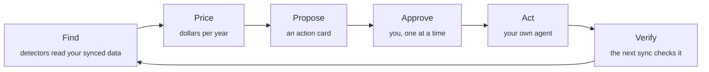

<p align="center">
  
</p>

<h1 align="center">Tidysum</h1>

<p align="center">
  <strong>The wealth manager's playbook, without the wealth manager's fee.</strong><br>
  Tidysum connects all your accounts, finds where your money is costing you and how much a year,<br>
  and has your own AI agent carry out the fixes you approve. You only step in to sign in or press Submit.
</p>

<p align="center">
  <strong>Bring your own AI.</strong> Tidysum has no model inside and works with any agent that speaks
  <a href="https://modelcontextprotocol.io">MCP</a>,<br>
  running whichever model you choose: Claude, GPT, Gemini, or one on your own machine.
</p>

<p align="center">
  <a href="#why-tidysum">Why</a> ·
  <a href="#quick-start">Quick start</a> ·
  <a href="#how-it-works">How it works</a> ·
  <a href="docs/guide.md">Guide</a> ·
  <a href="DISCLAIMER.md">Disclaimer</a> ·
  <a href="LICENSE">MIT License</a>
</p>

---

> [!IMPORTANT]
> Tidysum is software you run yourself. It is not a financial adviser or a registered investment
> adviser, and nothing it shows or drafts is financial, tax or legal advice. You approve every
> action, your own AI agent carries it out, and you are responsible for both. Read the
> [disclaimer](DISCLAIMER.md) before you use it.

## Why Tidysum

Most people would rather not think about their money. The usual way out is to hire a financial
adviser or wealth manager, and most of them charge a percentage of everything you have, every
year: a median of about **1% on the first $1 million**, and more on smaller accounts
([Kitces Research, via SmartAsset](https://smartasset.com/financial-advisor/financial-advisor-cost)).
That sounds small. Compounded, it isn't:

| You start with | After 30 years, a 1% yearly fee has cost you |
| -------------- | -------------------------------------------- |
| $250,000       | about $351,000                               |
| $500,000       | about $701,000                               |
| $1,000,000     | about $1.4 million                           |

That is about a quarter of what you'd otherwise end up with. (6% a year before fees, the same
0.05% index funds either way, no new savings. The working, other fee models and sources are in
[What advice costs](docs/what-advice-costs.md).)

Much of what you'd pay for is a well-known playbook that most advisers share, because it works:
a broad, low-cost index-fund mix, an emergency fund, the full employer match, cash that earns a
real rate, the right card for how you spend. Tidysum runs that playbook for you with software and
the AI agent you already use, and shows its working in dollars. It suggests things like:

- _"Send your paycheck to a high-yield savings account instead of checking that pays 0%: about
  $1,100 a year more in interest."_
- _"With what you spend on groceries and dining, this card earns about $310 a year more than the
  one you use."_
- _"$18,000 is sitting above your cash cushion. Put it into your index-fund mix, here's the split."_
- _"Your 401(k) fund charges 0.65%. The plan's own index funds copy it for 0.04%."_

<sub>Illustrative examples. Real findings use your accounts, your rules and published rates.</sub>

Tidysum is for people who **don't want investing to be a second job**: who'd like their money looked
after the way a good adviser would, without watching markets, reading fund fact sheets, logging
in to six websites or handing over a percentage. It does the noticing, the arithmetic and, with
your agent, the legwork. You make the calls.

- **Everything in one place.** Connect your banks, cards, brokerages and retirement plans with a
  free Plaid account, or import a CSV. Your data stays in a Postgres database on your own computer.
- **Every finding has a price.** Not "your allocation drifted" but "this costs you $240 a year,
  and here is the fix".
- **One decision at a time.** Fixes arrive as plain action cards. Approve one, skip one, reorder
  them, or schedule one for a later date.
- **Your agent does the legwork.** Bring the AI agent you already use, with any model: Claude
  Code, Codex, Gemini CLI, Cursor or any other MCP client. Once you approve an action, it does the
  work in your browser, on the institution's own website: filling in the account application,
  moving the direct deposit, changing your 401(k) contribution, or preparing the trades that
  invest idle cash in your index funds or rebalance your 401(k). It takes each one as far as the final review screen and hands back to you
  only for what has to be you: signing in, a code, an identity check, and pressing **Submit**.
- **No percentage.** Tidysum is free, open-source software that runs on your computer. It takes no
  fee on your assets and no referral money from anyone it recommends.
- **Calm by design.** New money does the rebalancing, so nothing you own gets sold to chase a
  target. Moves that would take money out of the market wait for calm markets.

## What it looks for

| Area                    | What Tidysum checks                                                                    |
| ----------------------- | -------------------------------------------------------------------------------------- |
| Cash                    | Cash above your buffer earning less than the best account you'd qualify for            |
| Idle cash, looking back | What that cash has already cost you, day by day, over up to two years                  |
| Credit cards            | Which card to use per spending category, cards missing from your wallet, foreign fees  |
| Card statements         | Statement balances that would cost interest if not paid in full by the due date        |
| Debt                    | Spare cash that would save more paying down the highest-APR debt                       |
| 401(k) contributions    | Missed match, room under the yearly limit, reaching the limit before the last paycheck |
| 401(k) funds            | Expensive funds that the plan's own index funds can copy exactly, sleeve by sleeve     |
| Brokerage windows       | Money in a plan's self-directed window that would be simpler and cheaper back inside   |
| IRAs                    | Unused Roth IRA room, including the backdoor Roth when income is over the limit        |
| Investments             | Where each new dollar should go to reach your target mix, without selling              |

Investment checks are off by default and only run for a user with investing turned on.

## How it works

Every feature is one step of a single loop ([decision 0003](docs/decisions/0003-misallocation-loop.md)):



Tidysum itself is plain, deterministic code: the sync, the detectors, the math, your policy, the
approval gate and an append-only audit log. It has **no AI of its own**. The intelligence comes
from the agent you bring ([decision 0005](docs/decisions/0005-actions.md)):

| Tidysum does                                          | Your agent does                                        |
| ----------------------------------------------------- | ------------------------------------------------------ |
| Syncs accounts and keeps the numbers exact            | Talks ideas through with you                           |
| Finds misallocations and prices them per year         | Reads your data through Tidysum's read-only MCP tools  |
| Checks every proposal against your hard limits        | Suggests fixes as proposals                            |
| Shows you one action at a time, and records your call | Carries out approved actions in your browser           |
| Confirms the result with the next sync                | Hands sign-ins, codes and the final Submit back to you |

### Built to be safe with your money

- **Nothing moves without your approval.** Agents can read and propose; only you approve, on
  Tidysum's own Actions page. There is no approve tool an agent could call. On a trade, your
  agent stops at the review screen and you press Submit yourself.
- **Agents can't see your secrets.** Agent queries run as a read-only Postgres role with
  row-level security. Plaid tokens are encrypted at rest and that role is never granted them.
- **Money is never a float.** Amounts are decimal strings in code and `numeric` in Postgres.
- **Everything is recorded.** Every proposal, approval and agent step is an append-only audit
  event, with the exact data it was checked against.
- **Bank text is data, never instructions.** Account and merchant names are marked untrusted for
  every agent that reads them.
- **No referral money.** Products are ranked only by what they'd gain you, from published terms.
  Tidysum has no affiliate links and no payout fields.
- **Local first.** It runs on your computer, and by default the admin page listens only on
  loopback.

## Quick start

Tidysum connects to your banks, cards, brokerages and retirement plans through
[Plaid](https://plaid.com). **Anyone can make a free Plaid account**, and its free Trial plan
connects up to 10 real institutions with no company and no cost. That is the whole setup: install
Tidysum, make the Plaid account, paste two keys, and sign in to your banks.

### The easy way: ask your agent

Your AI agent can do nearly all of it. In [Claude Code](https://claude.com/claude-code) (with
[Claude in Chrome](https://claude.com/chrome) for the browser steps), or any agent that can run
commands and use a browser, paste:

```text
Set up Tidysum for me: clone https://github.com/lucidity-finance/tidysum, follow
docs/connect-your-accounts.md, and connect my accounts. Stop and hand over to me
whenever a step needs my password, a code, my identity or my agreement to terms.
```

It installs Tidysum, opens Plaid's sign-up for you, puts your keys in place, starts Tidysum and
opens the page where you link your banks. You only step in for what is yours: your Plaid password
and codes, Plaid's identity check and terms, and signing in to each bank inside Plaid's window.
Your bank passwords never pass through your agent or Tidysum.

### By hand

You need Node 22.19 or newer, [pnpm](https://pnpm.io) and Docker.

```sh
git clone https://github.com/lucidity-finance/tidysum.git && cd tidysum
pnpm install
docker compose up -d                  # Postgres on 127.0.0.1:5432
cp .env.example .env                  # then fill in the four lines below
```

1. **Make a free Plaid account** at [dashboard.plaid.com/signup](https://dashboard.plaid.com/signup)
   and choose **Personal use**. New U.S. and Canadian accounts start on the Trial plan, with real
   data included.
2. **Fill in `.env`:** from **Developers → Keys** in the Plaid dashboard, `PLAID_CLIENT_ID` and the
   Production secret as `PLAID_SECRET`; set `PLAID_ENV=production`; and set `TIDYSUM_TOKEN_KEY` to
   the output of `openssl rand -base64 32`. Keep that key safe: losing it means linking every
   account again.
3. **Start Tidysum:**

   ```sh
   pnpm tidysum migrate
   pnpm tidysum serve                 # open http://127.0.0.1:8080
   ```

4. **Connect your accounts:** on the **Connections** page, click **Link institutions** and sign in
   to each bank, card and brokerage in Plaid's window. Tidysum syncs two years of history right
   away, then every six hours.

[Connect your accounts](docs/connect-your-accounts.md) explains every step, what counts toward the
10 free connections, and how to try it first with Plaid's test bank. Institutions Plaid can't reach
can come in as CSV (`pnpm tidysum import-csv`). On a Mac, `deploy/macos-setup.sh` runs it all in
the background and keeps it running ([guide](docs/guide.md#running-on-your-mac)).

### Connect your agent

With Claude Code, run this once in the repo, in your own terminal:

```sh
pnpm tidysum agent setup              # --dry-run shows what it would change
```

It registers Tidysum's MCP server, links the [tidysum-actions skill](skills/tidysum-actions/SKILL.md)
(the workflow and rules your agent follows), and allows Tidysum's tools so your agent isn't stopped
at every step. None of that lets it move money: approvals stay with you.

Then ask it things like _"What is my money costing me?"_ or _"Carry out my approved Tidysum
actions."_ For browser steps, give it a browser tool such as Claude in Chrome.

Tidysum doesn't care which agent or model you use. Any other MCP client works the same way: run
`pnpm -s --dir /path/to/tidysum tidysum mcp` as a stdio server, or set `TIDYSUM_MCP_TOKEN` and use
the Streamable HTTP endpoint at `/mcp`. Give it
[skills/tidysum-actions/SKILL.md](skills/tidysum-actions/SKILL.md) as instructions, the way you would
any agent rules file.

### Make it yours

The quickest start is a **money style**: a well-known way of running money that fills in your
rules for you. Pick one on the Plan page, or with `pnpm tidysum policy style <id>`:

| Style            | Known from                                        | In short                                                    |
| ---------------- | ------------------------------------------------- | ----------------------------------------------------------- |
| Debt-free first  | Dave Ramsey                                       | $1,000 cushion, smallest debt first, no cards, 75/25 stocks |
| Index and chill  | Jack Bogle, the Bogleheads                        | Three index funds, your age in bonds                        |
| Early retirement | the FIRE movement, Mr. Money Mustache, JL Collins | 1 month of cash, 100% US stock index                        |
| Classic 60/40    | most wealth managers and balanced funds           | 60% stocks, 40% bonds, 6 months of cash                     |
| All weather      | Ray Dalio, as popularized by Tony Robbins         | 30% stocks, 55% Treasuries, 7.5% gold, 7.5% commodities     |
| Safety first     | Suze Orman                                        | 8 months of cash, no card debt                              |

Tidysum isn't affiliated with or endorsed by any of these people. A style only fills in your
policy, so you can change any rule afterwards; `pnpm tidysum policy styles` shows what each would
change, and [decision 0009](docs/decisions/0009-money-styles.md) how each one is applied.

Or write your rules yourself. Tidysum works from three files you write and keep out of git:

| File             | What it holds                                                     | Start from                                         |
| ---------------- | ----------------------------------------------------------------- | -------------------------------------------------- |
| `policy.json`    | Your hard rules: cash buffer, target mix, caps                    | [`policy.example.json`](policy.example.json)       |
| `plan.md`        | Your plan in words: goals, where each dollar goes, rules you keep | [`docs/plan.example.md`](docs/plan.example.md)     |
| `workplace.json` | Your 401(k) as its website shows it: pay, elections, fund lineup  | [`workplace.example.json`](workplace.example.json) |

Load them with `pnpm tidysum policy set policy.json`, `pnpm tidysum plan set plan.md` and
`pnpm tidysum workplace set <account_id> workplace.json`. Your agent reads the plan before it
suggests anything and keeps its suggestions inside it.

## Status

Tidysum syncs, finds, prices, proposes and records approvals today. Your agent carries out approved
actions in your browser: opening accounts, moving a direct deposit, changing 401(k) contributions,
and trades, such as investing idle cash in your index funds at your brokerage or rebalancing your
401(k). It prepares each order up to the broker's or plan's review screen, and you press Submit.
**Nothing in this repository can move money on its own**, and placing trades from Tidysum itself,
through a broker's API (Phase 4), is not built.

| Phase | What                                                         | State                |
| ----- | ------------------------------------------------------------ | -------------------- |
| 0     | Setup, Plaid Sandbox sync, Robinhood MCP spike               | done (spike pending) |
| 1     | Real accounts, scheduled sync, webhooks, CSV import          | done                 |
| 2     | Read-only MCP server for agents                              | done                 |
| 3     | Policy, findings, proposals and approvals; agent-run actions | done                 |
| 3b    | Trades prepared by your agent, submitted by you              | done                 |
| 4     | Trades placed by Tidysum itself, through a broker's API      | not started          |

It is built and used by one person on their own money, so expect rough edges, U.S. accounts only,
and a Mac-first setup.

## Learn more

- **[Connect your accounts](docs/connect-your-accounts.md):** the free Plaid account and linking,
  step by step.
- **[What advice costs](docs/what-advice-costs.md):** what advisers, planners and robo-advisers
  charge, and what a 1% fee costs over the years.
- **[Guide](docs/guide.md):** every command, detector and rule, running on a Mac, layout and CI.
- **[Decisions](docs/decisions):** why Tidysum is built the way it is. Start with
  [the misallocation loop](docs/decisions/0003-misallocation-loop.md) and
  [the product principles](docs/decisions/0002-product-principles.md).
- **[Agent skill](skills/tidysum-actions/SKILL.md):** what your agent is told to do, and not do.

## Contributing

Issues and pull requests are welcome. Before you open one, read the
[design rules](docs/guide.md#design-rules-that-already-hold) and make sure this passes:

```sh
pnpm typecheck && pnpm lint && pnpm test
```

Tests start a throwaway Postgres in Docker. CI runs the same checks on every pull request.

## Contact

Like Tidysum, or want to work with the person behind it? Write to
[hello.tidysum@proton.me](mailto:hello.tidysum@proton.me). For bugs and feature requests, please
open an issue instead.

## License

[MIT](LICENSE). Provided as is, with no warranty and no liability: see the
[disclaimer](DISCLAIMER.md).
